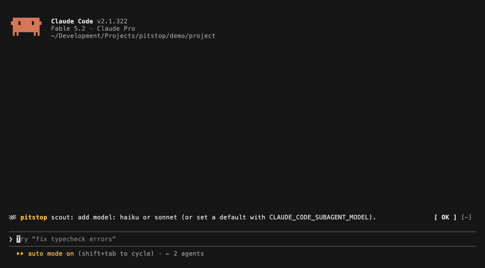

<p align="center">
  
</p>

<h1 align="center">pitstop</h1>

<p align="center">
  <b>The right Claude model, at the right moment.</b><br>
  Claude Code mods that coach your model, effort and context use, one line at a time.
</p>

<p align="center">
  <a href="LICENSE"></a>
  
  <a href="https://github.com/ilkayGkbdk/pitstop/actions/workflows/ci.yml"></a>
  
  
  <a href="https://github.com/ilkayGkbdk/pitstop/stargazers"></a>
</p>

<p align="center">
  
  <br><sub>▶ <a href="demo/walkthrough.mp4"><b>Watch the 50-second walkthrough</b></a> (real turns: failing tests, a model switch, the pit report) · <a href="demo/demo-tr.gif">Türkçe demo</a></sub>
</p>

## Why

Switching to a smaller model with 120K tokens of context can re-pay the cache write for the
whole history. Leaving Fable drops the earlier reasoning. `max` effort on a mid-size model
often costs more than the next model up at `medium`. Subagents without a `model:` line
quietly run on your most expensive model.

Claude Code already exposes these signals, and **model-coach** puts them in front of you
the moment they matter: one line above the prompt, at most once per session for each rule.
The rules come from Anthropic's guide
[Which Claude model should you build with?](https://claude.dev/blog/which-claude-model-should-you-build-with/)

## Install

At the prompt of a Claude Code terminal session:

```
/plugin install model-coach --marketplace ilkayGkbdk/pitstop
```

Answer `y` to add the marketplace, then pick a scope (user scope = every session).
From a shell: `claude plugin install model-coach --marketplace ilkayGkbdk/pitstop`

## What it watches

### Layer 1: tips above the prompt

| When | Tip |
| --- | --- |
| `/model` switch with context > **50K** | Run `/compact` first, since the new model pays cache-write for the whole history (shows the estimated $) |
| **Fable** → a lower model | Earlier thinking/reasoning will be dropped |
| Context > **150K** | Keep the main thread lean and hand log/file reading to a Haiku subagent |
| Effort above **high** | Try the next model up at lower effort instead |
| `.claude/agents/*.md` with no `model:` | Add `model: haiku` or `sonnet`, or set `CLAUDE_CODE_SUBAGENT_MODEL` |
| `Explore` runs on the session model | Define your own Explore with `model: haiku` |
| `opusplan` is active | Code edits run on Sonnet, so measure it on your own work |
| Automatic fallback | Shows which model the session fell back to |
| **Cache went cold** (idle past its TTL, big context) | The next request re-writes the history anyway, so switching models now costs nothing extra |
| A rate-limit window ≥ **80%** | Move routine work one model down to stretch it (shows when it resets) |
| **3 failing tool calls** in a row | The escalation ladder: give it a check → raise effort → move up a model at lower effort |
| Compaction **≤ 3 turns** away | Forecast from your context growth per turn, so you can `/compact` at a good stopping point |

Each rule fires **at most once per session** (`/clear` resets the cooldown). Mute any rule for good with `/model-coach mute <rule>`.

### Layer 2: routing rules for the model

A short system-prompt section asks Claude to open a reply with a single `🏁 pitstop: …`
line, in your language, and only when the kind of work clearly changes:

- **Haiku**: classification, routing, extraction, log reading, file search
- **Sonnet**: well-scoped bug fixes, features to spec, chat
- **Opus medium**: everyday engineering, multi-PR features
- **Fable**: big refactors and migrations, architecture, orchestrating many subagents

When a model falls short, the escalation order is: give it a verification path → raise
effort one level → move one model up at lower effort.

### Pit report

```
/model-coach report
```

```
Pit report · session cost $3.42
  main claude-opus-5-5: 14 turns · in 2.1M · out 48K · cache hit 91% · ~$2.71
  sub  claude-opus-5-5: 6 turns · in 310K · out 22K · cache hit 64% · ~$0.71
  Tip: the subagents spent ~$0.71; on Haiku 5.5 it would be ~$0.02 (−$0.69).
  Costs are estimates from list prices in the catalog.
```

<sub>Example output. Your numbers come from your own session.</sub>

## A catalog that stays current

Model names, families and list prices live in
[`catalog.json`](plugins/model-coach/catalog.json), not in the code:

- The mod ships with a bundled copy and refreshes it from this repository **at most once a day**.
  Nothing about you or your session is sent; it is a plain `GET` of a public file.
  Turn it off with the `remoteCatalog` option.
- A weekly GitHub Action lists the models the API serves and **opens a PR** for any new
  Claude model. Once it's merged, every install picks up the new names within a day,
  with no new release and no reinstall.

## Commands

| Command | What it does |
| --- | --- |
| `/model-coach status` | Model, effort, context, language, catalog source, what fired, what's muted |
| `/model-coach report` | Cost per model, cache hit rate, subagent savings estimate |
| `/model-coach rules` | Every rule: on/muted, fired this session |
| `/model-coach mute <rule>` · `unmute <rule>` | Silence one rule across sessions |
| `/model-coach lang en\|tr\|auto` | Tip language (`auto` follows Claude Code's `language` setting, then `LANG`) |
| `/model-coach on\|off` | The whole coach |

## Configure

Options (set in `/config` or at install): `language` (`auto`/`en`/`tr`), `remoteCatalog`, `injectRouting`.

Every threshold lives in one object,
[`plugins/model-coach/hooks/config.ts`](plugins/model-coach/hooks/config.ts):

```ts
switchCompactTokens: 50_000,  leanContextTokens: 150_000,  maxComfortEffort: 'high',
cacheTtlMs: 5 * 60_000,       rateLimitPercent: 80,        errorStreak: 3,
compactAtPercent: 90,         forecastTurns: 3,            maxQueued: 5,
```

## How it works

model-coach is a Claude Code mod: a single hooks module, with no background process. Its only
network call is the daily catalog fetch.

| Signal | Read from |
| --- | --- |
| Model switch, context size, cache cost, cache TTL | `classic.PreModelSwitch` |
| Effort, the model actually sent | `turn.step` on the main loop |
| Context fill, rate limits, session cost | `$.session.usage()` after each turn |
| Token use per model | `turn.complete` usage, main loop and subagents |
| Failing tool calls | `tool.call` results |
| Explore's model | `agent.spawn` result vs. `parentModel` |
| Fallback | `classic.PostModelSwitch` with `source: 'auto'`, or a step model that differs from the session's |

Known limits, stated honestly:

- The fallback rule cannot tell a *safety* fallback from other automatic switches.
- The compaction forecast assumes compaction at 90% of the window.
- Report costs are list-price estimates. The session total comes from Claude Code itself.
- Turning layer 2 off takes effect on the next thread or after `/compact`, because the
  system prompt stays fixed for a thread to keep the prompt cache.

## Develop

```sh
claude --plugin-dir ./plugins/model-coach   # load from disk; hot-reloads on save
claude plugin test ./plugins/model-coach    # 21 tests: rules, catalog, i18n, report, band, commands
claude plugin validate ./plugins/model-coach
node scripts/build-catalog.mjs              # after editing catalog.json
vhs demo/demo.tape                          # re-record the GIF (demo-tr.tape for Turkish)
```

Adding a language means adding one table to [`hooks/i18n.ts`](plugins/model-coach/hooks/i18n.ts); the type checker
lists every string you missed.

## Contributing

pitstop is built to be extended, and most changes are small:

- 🌍 **A new language**: one table in `i18n.ts`, and the type checker lists what's missing
- 💡 **A rule idea**: tell us the moment you wished Claude Code had warned you ([open one](https://github.com/ilkayGkbdk/pitstop/issues/new?template=rule-idea.yml))
- 📒 **Catalog updates**: a new model or price is a one-file PR
- 🧰 **A new mod** for the garage

Start with [CONTRIBUTING.md](CONTRIBUTING.md) and the
[good first issues](https://github.com/ilkayGkbdk/pitstop/labels/good%20first%20issue).

## Roadmap

- [x] English and Turkish tips
- [x] Pit report and per-rule mute
- [x] A self-updating model catalog
- [ ] More languages (PRs welcome: one table)
- [ ] Spot batch work that could run at low effort with retries
- [ ] More mods in the pitstop garage

## License

[MIT](LICENSE)
